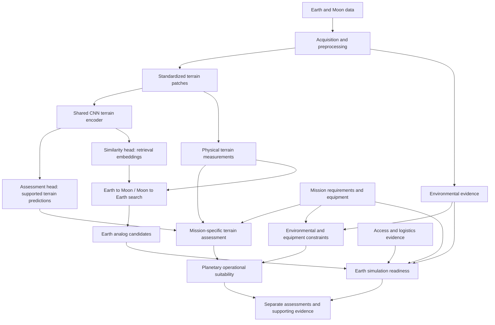

# Technical Pipeline & Data Sources

**Active project scope — 2 November 2026:** Earth and Moon only. Mars is excluded, including future extensions. The broader challenge wording and Mars references below are historical context, not planned work. Current decisions are summarized here; the [notebook index](notebooks/README.md) links to methods, evidence and running instructions.

**Project:** NASA Space Apps Challenge 2026

**Challenge:** Identify Earth Locations that Analog the Permanent Moon Base Locations and Mars

**Focus:** Geospatial AI, Computer Vision, Environmental Suitability, Mission Planning

## 1. Project Overview

This project is an AI-assisted planetary exploration platform that evaluates potential Moon and Mars locations based on environmental conditions, terrain difficulty, and the capabilities of available survival and exploration equipment.

The project will also identify similar terrestrial environments where astronauts and robotic systems can conduct simulations and prepare for planetary operations.

The system consists of three primary components:

1. **Environmental and Equipment Suitability Engine:** Evaluates whether a specified mission can operate in an environment, considering environmental hazards, survival requirements, equipment capabilities, and operational limitations.

2. **CNN Terrain Assessment:** Characterizes terrain and, where supported by labels, predicts how its spatial arrangement affects a specified operation. Physical measurements and equipment limits determine which characteristics are problematic for that mission.

3. **CNN Terrain Similarity Search:** Retrieves Earth terrain that reproduces the conditions relevant to an exercise at a selected lunar location. Moon-to-Earth retrieval is the primary task; reverse search is a secondary diagnostic. Environmental suitability and practical access are assessed separately.

### First similarity use case: rover route-planning practice

**Goal:** given a lunar terrain patch, find Earth terrain on which a team could practise comparable route-planning decisions. Start with 960 m patches on the current 30 m grid. Compare broad slopes, ridges, depressions and uneven areas; grid spacing does not establish equal effective resolution. This first exercise does not certify rover passability or reproduce lunar gravity, soil, traction, wheel-scale obstacles, communications or thermal conditions.

**Current target — proof of concept:** demonstrate that the existing trained CNN can take a lunar query and retrieve Earth terrain candidates relevant to this exercise, within the available data and compute. Beating the physical baseline is not a completion requirement. Reuse saved weights and embeddings; further training, a larger benchmark and completion of all 44 review ratings are optional follow-up work.

The demonstration should:

- Run the lunar-query → CNN embedding → ranked Earth-candidate path reproducibly, with identifiable locations and source data.
- Show a few actual CNN retrieval examples with side-by-side terrain, relief and slope measurements, and an explanation of the plausible exercise correspondence. Keep candidate-selection methods visible; do not present geographic supplements or baseline results as CNN results.
- Include a weak or uncertain result and state the limited region coverage and resolution. Describe the outcome as a feasibility demonstration; general accuracy and mission suitability remain unvalidated.

**Current inference and comparison:** notebook 34 reuses the saved CNN and training scaler, averaging embeddings over four quarter-turn rotations and their reflections for both Moon queries and Earth candidates. This creates a separate cache; original four-rotation caches remain separate. Notebook 35 compares all four trained CNN variants on shared locations using their original four-rotation embeddings. It supports choosing full-context, region-balanced for the demo: a tie for the highest top-five physical-hit rate, with lower slope and relief errors than the other tied model. This is a development-based choice; another CNN has the lowest relief error overall. Notebook 36 demonstrates the chosen model using the eight-orientation cache and compares slope magnitude, patch-mean-relative elevation and local elevation variation at a fixed physical scale. Preserve height differences in metres; absolute elevation is not a matching target. Physical measurements explain the CNN results without reranking them. Orientation consistency is checked separately from retrieval relevance.

The rubric below can guide example explanations or optional later review. For a scored review, record **0 = poor correspondence, 1 = partial, 2 = close, U = insufficient evidence**, with a short explanation. These are provisional review categories, not trained labels or equipment limits. Keep dimensions separate; do not turn them into an unvalidated total score.

| Dimension | What must Earth reproduce for this exercise? |
| --- | --- |
| Physical scale | Comparable relief and slopes over the same ground distance; a similar-looking shape at a very different vertical scale is insufficient. |
| Landform arrangement | Comparable broad ridge/valley/depression structure and relative placement of flatter and steeper areas. |
| Route-planning challenge | Comparable choices about going around versus across broad terrain features; explain the relevant feature without claiming a traversable route. |
| Evidence confidence | Record source/support limitations separately as high, medium, low or unknown. A visually plausible match can still have weak evidence. |

For each query, record **promising / partial / none among reviewed candidates / uncertain**, plus the missing condition. “None” applies only to the reviewed set. Quarter-turn rotations and reflections are acceptable for this terrain-only exercise; direction-dependent lighting and communications remain separate. Do not rescale heights to make a pair appear similar. Climate, land cover, access, permissions and equipment feasibility are later checks on whether a terrain analog is usable.

**Status:** broad EDA and the similarity CNN proof of concept are complete. Notebook 35 records the model comparison and choice; notebook 36 is the current demonstration. The next stage is to connect candidate terrain with environmental, access and equipment checks. Notebook 33's rating forms and further training remain optional follow-up work; independent relevance judgments are required before broader accuracy claims.

### Current findings and evaluation decisions

| Finding | Decision |
| --- | --- |
| High CNN cosine can coexist with large slope or relief differences. The physical baseline performed better on descriptor agreement in notebook 30. | Keep physical measurements and weak examples visible. Descriptor bands are not relevance labels, mission limits or a similarity percentage. |
| Candidate matches reuse locations and are sensitive to land-cover screening; relaxed Arizona screens included woody cover. | Keep screening alternatives separate. More nearby patches do not establish geographic transfer. |
| Lunar full-context terrain can be prior-dominated; matching grid spacing does not establish matching effective resolution. | Retain full-context and image-supported views separately and report source limitations. |
| Requiring every thermal product removes regions; phase averages and mean illumination do not describe extremes or continuous darkness. | Preserve missingness and native environmental resolution; mark unsupported constraints Unknown. |
| OSM does not establish permission, passability or emergency readiness. | Assess practical access, equipment limits and environmental suitability separately. |

The original Arizona elevation gaps were a tile-selection defect; derivative losses required more processing context. Lunar elevation holes were introduced by our support mask. These issues were corrected; historical masked maps do not establish missing source heights. Current full-context elevation is complete inside the seven selected lunar ROIs. Genuine environmental missingness and derivative edge exclusions remain distinct.

- **Development data:** Arizona, Lanzarote, Atacama, Death Valley, Wadi Rum and the seven explored lunar regions. Atacama and Leibnitz are EDA-exposed development holdouts, not untouched final tests. Climate and mapped-support coverage exist for all five Earth sites.
- **Split policy:** keep overlapping patches, scales, augmentations, support views and source versions together. Check full feature context, currently at least 150 m beyond grid footprints. Fit normalization on training regions only.
- **Proposed reserves:** Earth validation—Askja and Flinders Ranges; Earth final—Mauna Loa and Namib–Sossusvlei; lunar validation—Peak Near Shackleton; lunar final—Amundsen Rim and Nobile Rim 2 as one conservative block. These roles are not yet verified or enforced. Keep reserves unopened; verify footprints, context and prior exposure before assigning roles. Exposure invalidates an untouched-test claim; do not replace a region because it performs poorly.
- **Later evaluation:** freeze the candidate pool, splits, preprocessing, model, top-k and review rubric. Evaluate unseen queries, unseen candidates and both unseen; report regional failures. Independent judgments and relevant equipment evidence remain future work. The current 960 m scale is provisional; additional scales and acquisitions need a concrete question.

Detailed findings remain in notebooks 14–33. Source-specific evidence is retained in the [environmental acquisition record](data/reference/environment-expansion-research-20261030/ACQUISITION.md), [units policy](data/reference/environment-readiness-20261028/REPORT.md), [Diviner interpretation](data/reference/environment-eda-research-20261029/SOURCES.md) and [region research](data/reference/region-diversity-20261029/REGION_RESEARCH.md).

### Two CNN tasks, separate outputs

| | Terrain assessment — Stage 2 | Terrain similarity — Stage 5 |
| --- | --- | --- |
| Question | What is this terrain like, and how could it affect the specified operation? | Which locations have comparable terrain morphology? |
| Learned output | Terrain characteristics; a difficulty prediction only with suitable labels | An embedding used to rank candidate matches |
| Evidence for evaluation | Independent terrain or mobility labels, or validated simulations tied to the mission | Current proof of concept: reproducible retrieval and explained examples; later validation: independent relevance judgments, including weak and no-match cases |
| Physical baseline | Measured slope, relief and local elevation variability | Retrieval using physical terrain descriptors |
| Downstream use | Mission-specific operational suitability | Earth analog selection and simulation readiness |

A steep, irregular patch may be difficult to traverse yet be an excellent analog for training on similarly difficult lunar terrain. A similarity score must not be interpreted as an assessment of mission suitability.

**Proposed architecture:** start with one shared terrain encoder and task-specific heads: an assessment head and a similarity head. These are two learning objectives, not an Earth CNN and a Moon CNN. Sharing is provisional; compare separate encoders if one task harms the other. Separately trained retrieval encoders would require alignment into a common embedding space.

**Implementation order:** notebook 28 prepares the dataset and physical retrieval baseline; notebook 29 implements the first bidirectional similarity-learning experiments. Use those saved models for the proof-of-concept demonstration. Independent relevance judgments remain necessary for broader performance claims. The assessment prediction head depends on suitable labels. Until then, assessment uses physical measurements and explicit mission constraints, with unsupported properties marked Unknown.

The results will be combined into two primary assessments:

- **Planetary Operational Suitability:** How suitable a Moon or Mars location is for a specified mission with the selected equipment.

- **Earth Simulation Readiness:** How useful and practical an Earth location is for reproducing relevant conditions from the chosen planetary environment.

These represent preliminary mission-planning assessments, not certified human safety or habitability ratings.

---

## 2. Data Sources

### 2.1 Terrain and Elevation Data

These datasets provide terrain information for both CNN applications.

| Dataset | Source | Data / Purpose |
| --- | --- | --- |
| Lunar enhanced south-pole SDEMs (primary) | [NASA PGDA — Enhanced Topography Models](https://pgda.gsfc.nasa.gov/products/104) · [Download archive (Zenodo)](https://doi.org/10.5281/zenodo.17954508) | 5 m-grid shape-from-shading elevation, slope, roughness and quality/coverage layers for 13 selected Artemis III candidate regions; primary lunar CNN terrain dataset. |
| Lunar LOLA south-pole large-area DEMs | [NASA PGDA — A New View of the Lunar South Pole](https://pgda.gsfc.nasa.gov/products/90) | Larger regional elevation, slope, hillshade, error, measurement-density and effective-resolution layers; wider-area screening and uncertainty assessment. |
| Lunar high-resolution LOLA DEM (alternative) | [NASA PGDA — South Pole Sites](https://pgda.gsfc.nasa.gov/products/78) | Additional lunar elevation, slopes, illumination-related analysis and uncertainty; use cautiously where sparse LOLA observations are interpolated. |
| Mars Jezero CTX DEM (primary) | [USGS — Science Investigation CTX DEM](https://astrogeology.usgs.gov/search/map/mars_2020_science_investigation_ctx_dem_mosaic) · [Direct GeoTIFF](https://planetarymaps.usgs.gov/mosaic/mars2020_trn/CTX/ScienceInvestigationMaps_JPL/M20_JezeroCrater_CTXDEM_20m.tif) | Jezero Crater 20 m/pixel elevation mosaic (~87 MB) for the Martian CNN input; source metadata identifies vertical units and projection. |
| Mars regional HRSC DTMs (extension) | [DLR Mars Express HRSC regional DTMs](https://hrscteam.dlr.de/public/data/regionaldtms.php) | Downloadable regional Mars elevation mosaics and orthorectified imagery to extend analysis beyond Jezero. |
| Mars MOLA global DEM | [NASA PDS — MOLA MEGDR](https://pds-geosciences.wustl.edu/missions/mgs/megdr.html) | Global/regional Mars elevation context; coarser than Jezero CTX. |
| Planetary archive discovery | [NASA PDS Orbital Data Explorer](https://ode.rsl.wustl.edu/) | Search and download location-specific Moon and Mars products from multiple instruments and missions. |
| FABDEM V1.2 | [University of Bristol — FABDEM](https://research-information.bris.ac.uk/en/datasets/fabdem-v1-2/) | Earth elevation (~30 m grid) with building and forest-height biases reduced; **CC BY-NC-SA 4.0**, non-commercial terms. |
| Copernicus GLO-30 / GLO-90 | [Public AWS Open Data — Copernicus DEM](https://registry.opendata.aws/copernicus-dem/) | Free, publicly listed COG elevation tiles (~30 m / ~90 m), with no AWS account needed for anonymous S3 access; DSM still contains structures and vegetation. |
| Polar Earth terrain (optional) | [REMA Antarctic DEM](https://www.pgc.umn.edu/data/rema/) · [ArcticDEM](https://www.pgc.umn.edu/data/arcticdem/) | Polar Earth surface-elevation mosaics for additional lunar-polar analog candidates. |

**Processing requirements:**

- Standardize physical ground resolution and patch dimensions.
- Calculate slopes, roughness, curvature and relative elevation.
- Preserve absolute physical measurements separately from normalized CNN inputs.
- Account for missing data, interpolation and uncertainty.
- Remove or exclude human-developed terrain where it would distort natural terrain comparisons.

Lunar 5 m-grid products may contain interpolation or shape-from-shading reconstruction and should not automatically be interpreted as 5 m independent direct measurements. Earth and planetary imagery must be compared at compatible **effective** resolutions and physical patch sizes. Use source-specific coordinate reference systems and vertical datums.

### 2.2 Planetary Environmental Data

These datasets provide environmental information for the Moon and Mars.

| Dataset | Source | Data / Purpose |
| --- | --- | --- |
| Lunar Diviner temperature products | [Diviner — Data and temperature maps](https://www.diviner.ucla.edu/data) | Global and polar lunar surface temperature statistics and extremes; links through to NASA PDS archives. |
| Lunar polar illumination and Earth visibility | [NASA PGDA — Lunar Polar Illumination](https://pgda.gsfc.nasa.gov/products/69) | Solar illumination fractions, permanent shadow, Earth visibility and sky visibility in GeoTIFF/COG and other formats; averages need further analysis for mission-specific continuous-darkness duration. |
| Lunar polar terrain-related shadow/uncertainty | [NASA PGDA — A New View of the Lunar South Pole](https://pgda.gsfc.nasa.gov/products/90) | Permanent-shadow context, local slopes and terrain/effective-resolution quality layers. |
| Lunar resource indicators (optional) | [Lunar Orbital Data Explorer](https://ode.rsl.wustl.edu/moon2/) | Search LEND/Lunar Prospector neutron/hydrogen products and Chandrayaan-1 M³ spectral observations; evidence of possible resources, not verified extractable water. |
| Mars Climate Database v6.2 (primary) | [LMD — MCD v6.2 interface](https://www-mars.lmd.jussieu.fr/mcd_python/index.html) | Modeled Mars air temperature, pressure, wind, dust scenarios and seasonal/local-time variation. Free interface for moderate manual use; full-data access may require registration. |
| Mars Perseverance MEDA | [NASA PDS Atmospheres — MEDA](https://pds-atmospheres.nmsu.edu/data_and_services/atmospheres_data/PERSEVERANCE/meda.html) | Measured environmental observations at/along the Perseverance rover's locations in Jezero; **not** a Mars-wide environmental grid. |
| Mars Odyssey thermal / resource products | [NASA PDS — Mars Odyssey](https://pds-geosciences.wustl.edu/missions/odyssey/) | THEMIS thermal products and GRS/neutron-derived indicators of elemental composition or hydrogen; broad/variable resolution. |
| Mars regional atmospheric and instrument archive (extension) | [NASA PDS — Mars Orbital Data Explorer](https://ode.rsl.wustl.edu/mars2/) | Search for instrument-specific Mars orbital environmental/thermal and geological products. |
| Human-system requirements and protection limits | [NASA-STD-3001 Volume 2, Rev F](https://standards.nasa.gov/node/237) · [Volume 1, Rev C](https://standards.nasa.gov/node/238) | Engineering requirement references; mission-specific equipment capability parameters must still be documented separately. |

**Environmental factors to evaluate:**

**A. Atmospheric and thermal conditions**

| Factor | Moon / Mars data or method | Operational relevance |
| --- | --- | --- |
| Surface temperature (typical, minimum, maximum) | Moon: Diviner; Mars: MCD, MEDA at Jezero | Suit/habitat thermal control, material and instrument operating limits |
| Atmospheric/air temperature and daily or seasonal cycles | Moon: no meaningful atmosphere; Mars: MCD, MEDA | Heating/cooling loads and planned exposure period |
| Atmospheric pressure and composition | Moon: near-vacuum assumption; Mars: MCD and planetary reference atmosphere | Pressurization, oxygen supply, sealing requirements |
| Thermal variation and continuous exposure duration | Derived from time-dependent temperature and mission schedule | Thermal cycling, cold-soak/hot-soak, equipment endurance |
| Wind speed and wind-driven conditions | Moon: no atmospheric wind; Mars: MCD, MEDA | Dust transport, equipment exposure, external operations |
| Humidity/water vapor | Mars: MCD/MEDA where available; not applicable as Earth-style lunar humidity | Context for environmental processes and hardware testing |

**B. Illumination and available power**

| Factor | Moon / Mars data or method | Operational relevance |
| --- | --- | --- |
| Solar illumination / solar energy availability | Moon: PGDA illumination; Mars: MCD solar flux/scenarios | Solar generation potential and base placement |
| Longest continuous darkness or low-power interval | Compute mission-window illumination using solar geometry + DEM; **not** from mean illumination alone | Battery/alternative power capacity and mission endurance |
| Seasonal/day-night illumination variability | PGDA + geometry; Mars seasonal and local-time calculations | Power planning and operating windows |
| Terrain shadowing | DEM + local horizon/solar geometry | Solar panels, rover navigation and line-of-sight |
| Dust-related solar losses | Mars: dust scenarios in MCD; lunar dust deposition requires separate assumptions | Panel efficiency and maintenance margin |
| Earth visibility / communications line-of-sight | Lunar PGDA Earth-visibility maps; terrain/ephemeris-derived geometry | Communications access, not the same as power availability |

**C. Radiation and physical hazards**

| Factor | Moon / Mars data or method | Operational relevance |
| --- | --- | --- |
| Background galactic cosmic radiation | Planetary radiation references / mission measurements, not necessarily fine-scale site maps | Shielding, exposure duration; treat as scenario input |
| Solar particle events | Event scenarios and mission-design references | Shelter and emergency procedures; not a static location score |
| Shielding effectiveness | Habitat/suit materials, geometry, assumed mass shielding | Equipment effectiveness and residual exposure uncertainty |
| Dust exposure and abrasion | Mars: MCD/MEDA dust context; Moon: published regolith/dust information | Seals, joints, optics, thermal surfaces |
| Micrometeoroids and seismic activity | Hazard reference models; limited local data | Structural risk; no unsupported precise per-site estimate |

**D. Water, geology and resources**

| Factor | Moon / Mars data or method | Operational relevance |
| --- | --- | --- |
| Evidence of water ice or hydrogen | Moon: neutron/spectral products; Mars: Odyssey neutron/GRS and other mapped indicators | Preliminary resource interest, **not** guaranteed usable water |
| Resource accessibility/extraction difficulty | Depth, concentration, material and equipment assumptions, often unmeasured | Determines whether a resource could practically support the mission |
| Mineralogy and geological materials | Moon: M³ spectroscopy; Mars: orbital mineral/thermal products | Scientific analog fidelity and possible raw materials |
| Regolith and soil mechanical behavior | Local mission observations, studies and physical assumptions | Excavation, dust and vehicle performance |
| Bearing strength, foundation stability, subsurface conditions | Not reliably inferred from coarse DEMs; add ground-truth/radar where possible | Base construction and vehicle loads |

**E. Planetary constants and conditions**

| Factor | Moon | Mars |
| --- | --- | --- |
| Gravity | Approximately 0.16 Earth gravity | Approximately 0.38 Earth gravity |
| External atmosphere | Near-vacuum | Thin, CO₂-dominated atmosphere |
| Solar day | Approximately 29.5 Earth days | Approximately 24 h 39 min |
| Breathable external air | None | None |
| Earth analog reproduction limitation | Natural Earth sites cannot reproduce lunar gravity/vacuum | Natural Earth sites cannot reproduce Martian gravity/pressure |

**Hard versus soft requirements:** Life-support sufficiency, atmospheric protection, critical power endurance, equipment temperature limits and mandatory mobility limits should be tested as **hard** mission constraints. Lower energy consumption, favorable illumination, reduced dust exposure or prospective resources may be **soft** requirements when not mission-critical. Failed or unknown hard requirements must not be disguised by a high total score.

Radiation, resource abundance, subsurface properties and some local hazards may not have sufficiently detailed public data for accurate site-specific assessment. These factors will be marked as uncertain or unassessed rather than assigned unsupported values. All environmental values should retain source, units, observation/model status, original spatial and temporal resolution, and uncertainty.

The Mars Climate Database provides **model-derived** estimates rather than direct local measurements. Full-data access can require free registration; its web interface is appropriate for moderate use rather than unrestricted automated bulk downloads. Lunar average illumination maps likewise do not directly establish worst-case continuous darkness for a given mission duration.

### 2.3 Earth Environmental and Accessibility Data

| Dataset | Source | Data / Purpose |
| --- | --- | --- |
| TerraClimate v1.1 (primary Earth climate) | [Climatology Lab — TerraClimate](https://www.climatologylab.org/terraclimate.html) · [Variable guide](https://www.climatologylab.org/terraclimate-variables.html) | Historical monthly ~4 km climate estimates, including min/max temperature, precipitation, wind, solar radiation, vapor pressure, snow-water equivalent and soil-moisture estimates; use v1.1 consistently. |
| WorldClim 2.1 (baseline) | [WorldClim — Historical Climate Data](https://www.worldclim.org/data/worldclim21.html) | Long-term 1970–2000 monthly temperature, precipitation, solar radiation, wind and vapor pressure; baseline climatology, **not** current daily weather. |
| ESA WorldCover 2021 | [ESA WorldCover — Data Access](https://esa-worldcover.org/en/data-access) | Free 10 m land-cover COGs: bare ground, water, vegetation, crops and built-up classes for candidate exclusion and test-zone selection. |
| OpenStreetMap regional extracts | [Geofabrik — Free OSM Downloads](https://download.geofabrik.de/) | Roads, settlements and mapped infrastructure; **support-zone logistics only**, excluded from CNN terrain inputs. |
| Global Human Settlement Layer (GHS-BUILT-S) | [European Commission JRC — GHS-BUILT-S](https://human-settlement.emergency.copernicus.eu/ghs_buS2023.php) · [Direct download selector](https://human-settlement.emergency.copernicus.eu/download.php?ds=bu) | Built-up surface density for screening human-developed patches. |

**Earth environmental factors to evaluate:**

| Factor | Primary data source | Relevance to Earth simulation readiness |
| --- | --- | --- |
| Temperature range and annual variability | TerraClimate; WorldClim baseline | Thermal training conditions and equipment exposure |
| Aridity, precipitation and seasonal rainfall | TerraClimate; WorldClim baseline | Desert-like fidelity, exposure/weather limitations |
| Bare-ground fraction and vegetation cover | ESA WorldCover | Natural test-zone fidelity and visibility of terrain |
| Built-up and cropland fraction | ESA WorldCover; GHSL | Reject or flag anthropogenic terrain patches |
| Wind exposure | TerraClimate | Equipment and crew testing conditions |
| Snow/ice and moisture conditions | TerraClimate (SWE/soil moisture); polar DEMs if used | Ice/polar training environments |
| Solar radiation | TerraClimate | Outdoor energy and thermal-load approximation |
| Isolation from settlements | GHSL, OSM regional extracts | Training remoteness and site screening |
| Roads, staging and support proximity | OSM/Geofabrik, evaluated outside the test zone | Operational feasibility, not planetary fidelity |
| Legal access, emergency response and local hazards | Requires site-specific verification; not reliably covered by these global datasets | Mark **Unknown** until verified; never infer safety from road data alone |

Earth sites will be separated into:

**Scientific Test Zone:** The natural terrain used for planetary comparisons and training simulations.

**Support Zone:** The surrounding area used to evaluate roads, facilities and logistical access.

This prevents the CNN from interpreting human infrastructure as useful planetary terrain while still allowing infrastructure to contribute positively to operational feasibility.

Earth climate fields are substantially coarser than terrain imagery, so they must retain their original resolution instead of being treated as 5–30 m measurements. The 2020/2021 ESA WorldCover maps used different processing versions; do not interpret their raw class differences as verified land-cover change.

### 2.4 Equipment and Human Survival Requirements

Unlike terrain and climate datasets, equipment capabilities will require a structured database created by the project team.

**Reference:** [NASA-STD-3001 — Spaceflight Human-System Standard, Volume 2 Revision F (14 July 2026)](https://standards.nasa.gov/node/237) and [Volume 1 Revision C](https://standards.nasa.gov/node/238).

The equipment database will contain configurable mission profiles, drawing on publicly documented capabilities when available and explicitly declared engineering assumptions otherwise.

| Equipment | Relevant parameters |
| --- | --- |
| Spacesuit | Life-support duration, thermal operating limits, pressure support |
| Habitat | Pressurization, insulation, environmental control, shielding assumptions |
| Rover | Traversable slope, operating temperature, power consumption, endurance |
| Power system | Generation capacity, storage, operational duration |
| Life-support system | Oxygen, water, consumables, crew capacity |
| Communication system | Coverage requirements, operating constraints, redundancy |

Equipment profiles must also include capability limits, assumptions, margins and data provenance.

The system will not assume that adding equipment automatically makes an environment safe.

---

## 3. Technical Pipeline

### Stage 1 — Data Acquisition and Standardization

**Input:** Earth, Moon and Mars elevation and environmental datasets.

1. Download selected planetary and terrestrial datasets.

2. Extract target areas and register their coordinates using appropriate planetary reference systems.

3. Standardize terrain grids to comparable physical resolutions and geographic extents.

4. Calculate elevation-derived representations, including slope, roughness, curvature and hillshade.

5. Identify missing measurements, interpolation artifacts and data-quality limitations.

6. Apply land-cover and infrastructure masks to terrestrial candidate terrain.

7. Associate environmental information with the corresponding locations, preserving its original spatial and temporal resolution.

**Output:** Standardized terrain patches and environmental feature records indexed by planetary body and location.

### Stage 2 — CNN Terrain Assessment

**Objective:** Describe terrain characteristics and assess their implications for a specified activity and equipment configuration. This stage evaluates terrain difficulty; it does not search for analog locations.

**Inputs:**

- Relative elevation maps.

- Slope distributions and slope maps.

- Terrain roughness.

- Curvature and landform arrangements.

**Model:**

A terrain encoder will learn spatial representations of morphology. A task-specific assessment head may use these features to predict terrain characteristics or mission-relevant difficulty. The encoder may be shared with Stage 5; the assessment output and training objective remain distinct.

The model will investigate features such as ridges, craters, steep transitions, irregular terrain and spatial arrangements that may complicate traversal or site preparation.

The current 30 m terrain grids cannot reliably identify individual rocks or small boulders. Rock and boulder hazard detection would require suitable higher-resolution evidence and labels. Local elevation variability must not be presented as a direct measurement of rockiness.

**Physical analysis:**

Deterministic calculations will measure observable characteristics including slope, local relief and roughness.

These measurements provide the baseline against which the CNN's additional value can be evaluated. Predicting a slope threshold calculated from the same input DEM would demonstrate imitation of that rule, not independent validation of mission difficulty.

A terrain-difficulty prediction head may be trained if suitable mobility labels or validated simulated labels are available. Otherwise, the CNN will provide morphology features while physical constraints determine the provisional difficulty assessment.

**Output:** Physical terrain measurements, supported terrain-characteristic predictions, and mission-specific difficulty indicators with their evidence and uncertainty. Difficulty predictions require suitable labels; unsupported hazards remain Unknown. Embeddings are an internal representation shared with retrieval, not the assessment result.

### Stage 3 — Environmental and Equipment Suitability Engine

**Objective:** Evaluate whether an intended mission can operate under the environmental conditions at a selected Moon or Mars site.

**Inputs:**

- Planetary environmental measurements or modeled estimates.

- Mission duration and intended activities.

- Crew requirements.

- Equipment capabilities and limitations.

- Environmental and operational safety requirements.

**Process:**

1. Retrieve environmental conditions for the selected site and intended operating period.

2. Load the mission's equipment configuration.

3. Define applicable hard constraints and soft requirements.

4. Estimate whether equipment capabilities meet environmental demands.

5. Evaluate consumables, power, thermal control and operational margins where sufficient parameters exist.

6. Identify failed requirements, uncertain requirements and remaining operational limitations.

7. Calculate preference scores only for candidates that satisfy the mandatory conditions.

**Hard constraints:** Essential conditions required for the mission to proceed, such as adequate life-support capacity or sufficient power reserves.

**Soft requirements:** Desirable conditions that improve operational efficiency, comfort, energy consumption or flexibility.

A constraint may be classified as **Passed, Failed or Unknown**. Missing data will not automatically be treated as a pass.

**Output:** Environmental suitability assessment, equipment adequacy, operating margins, failed requirements and uncertainty indicators.

### Stage 4 — Planetary Operational Suitability Assessment

**Objective:** Combine environmental, equipment and terrain assessments into a preliminary mission-specific location evaluation.

**Inputs:**

- Environmental and equipment assessment from Stage 3.

- Terrain assessment from Stage 2.

- Mission requirements.

**Process:**

1. Evaluate mandatory environmental and equipment constraints.

2. Evaluate terrain-related mission constraints.

3. Exclude or flag sites failing mandatory requirements.

4. Calculate normalized scores for eligible candidates.

5. Weight the criteria according to the mission profile.

6. Provide ranked candidates with explanations of limiting factors.

**Output:** Planetary Operational Suitability Score and supporting assessment.

This score evaluates the feasibility of a specified operation with specified equipment. It is not a probability of human survival or an official landing-site certification.

### Stage 5 — CNN Earth Analog Similarity Search

**Objective:** Find Earth locations with morphology comparable to a selected lunar patch. This stage evaluates resemblance; Stage 6 determines whether a candidate is practical for the intended training exercise.

**Inputs:**

- Selected planetary terrain patch.

- Standardized Earth terrain patches.

- CNN embeddings and physical terrain descriptors.

**Model:**

A CNN terrain encoder will generate a numerical representation of each location.

The proposed model shares the terrain encoder with Stage 2 and uses a separate similarity head to produce retrieval embeddings. Train this head for terrain resemblance, not for predicting difficulty or selecting only easy terrain. Use a separate encoder only if evaluation shows that sharing harms a task.

A similarity-search algorithm will compare embeddings using cosine similarity or another validated distance function.

**Process:**

1. Extract terrain embeddings for the selected planetary location.

2. Search the Earth terrain database for similar embeddings.

3. Retrieve the strongest candidate matches.

4. Compare physical terrain properties to verify morphological similarity.

5. Remove candidates affected by inappropriate land cover or insufficient data quality.

6. Retain candidate locations for environmental and operational screening.

A corresponding Earth-to-Moon search uses the same encoder, similarity head and embedding database, with the query and candidate bodies exchanged. Evaluate both directions separately: symmetric pairwise similarity does not guarantee reciprocal nearest-neighbor rankings.

**Output:** Ranked terrain-similarity candidates and their measurable differences from the target. The current proof of concept demonstrates the retrieval path with explained examples. Broader validation would require independent relevance judgments; neither training loss nor agreement with the physical baseline establishes analog relevance. A high similarity score does not establish low terrain difficulty, safe access or mission suitability.

### Stage 6 — Earth Simulation Readiness Assessment

**Objective:** Determine whether Earth analog candidates are suitable for the required mission training or equipment tests.

**Inputs:**

- CNN terrain similarity.

- Earth environmental conditions.

- Land cover and infrastructure.

- Access and logistical requirements.

- Specific mission-training objectives.

**Process:**

1. Evaluate terrain fidelity relative to the planetary location.

2. Compare mission-relevant environmental characteristics.

3. Identify which planetary conditions can and cannot be recreated naturally.

4. Assess the suitability of the Scientific Test Zone.

5. Evaluate accessibility and logistical support separately.

6. Apply hard constraints and soft preferences.

7. Rank locations by simulation fidelity and operational practicality.

Outdoor Earth locations cannot naturally reproduce lunar or Martian gravity, vacuum or atmospheric pressure. These discrepancies will be listed explicitly; specialized facilities would be required to simulate some conditions.

**Output:** Earth Simulation Readiness Score, recommended analog locations, fidelity breakdown and logistical limitations.

### Stage 7 — Final Ranking and Recommendation

Two separate scores will be provided.

**A. Planetary Operational Suitability Score**

Evaluates the compatibility between planetary environmental conditions, terrain characteristics, mission requirements and equipment capabilities.

**B. Earth Simulation Readiness Score**

Evaluates how closely a terrestrial location replicates mission-relevant planetary conditions and how practical it is for training or testing.

Each score will be formed using a deterministic multi-criteria algorithm after mandatory conditions have been evaluated.

The platform will provide individual criterion scores, overall rankings, alternative candidates with different trade-offs, and explanations of uncertainty.

The two scores will remain separate rather than being combined into a universal habitability rating.

### Stage 8 — Interactive Application

The final web application will allow users to:

- Select a location on the Moon or Mars.

- Specify mission objectives, mission duration and equipment configurations.

- View environmental and terrain conditions.

- Assess operational suitability and limiting factors.

- Compare alternative planetary locations.

- Search for similar terrain on Earth.

- Evaluate terrestrial simulation and training sites.

- Adjust hard constraints and soft requirements.

- Inspect candidate rankings, visual terrain comparisons and uncertainty.

All essential datasets and model outputs will be stored locally wherever practical to avoid reliance on paid services and live API calls.

---

## 4. Overall Pipeline

The two terrain branches answer different questions. The shared encoder below is the starting architecture; the assessment head remains conditional on suitable labels.

Assessment combines supported terrain predictions with physical measurements and mission constraints. Retrieval ranks morphological resemblance. Environmental evidence and access checks remain separate from the CNN terrain representation.

---

## 5. Implementation Scope

The initial prototype will include:

- Data acquisition, alignment and terrain preprocessing.
- A shared CNN terrain representation, with distinct assessment and similarity objectives; physical baselines provide context without a requirement to outperform them for the proof of concept.
- Bidirectional Earth–Moon terrain retrieval; a learned assessment head only when suitable labels are available.
- Environmental and equipment hard/soft constraint system.
- Planetary operational suitability assessment.
- Terrestrial simulation readiness assessment.
- Integrated ranking and interactive demonstration.
- Reproducible example checks and documentation; broader model validation is follow-up work.

The prototype will be a functional end-to-end system using a limited number of locations, one or two mission scenarios, and clearly defined equipment profiles.

CNN fine-tuning, complex hazard prediction and broader environmental analysis can be expanded if time permits.

---

## 6. Expected Outputs

**Planetary site report**

- Location and terrain characteristics.

- Environmental conditions.

- Equipment capability assessment.

- Mandatory requirement status.

- Terrain mobility difficulty.

- Planetary Operational Suitability Score.

- Uncertainties and limiting factors.

**Earth analog report**

- Recommended terrestrial simulation locations.

- CNN terrain similarity and physical-feature comparison.

- Environmental simulation fidelity.

- Scientific Test Zone characteristics.

- Support-zone accessibility.

- Earth Simulation Readiness Score.

- Strengths, limitations and unmet training requirements.

**Final project deliverable**

A functional geospatial AI platform combining terrain analysis, cross-planet similarity retrieval, equipment-aware environmental assessment and explainable mission-specific ranking.
